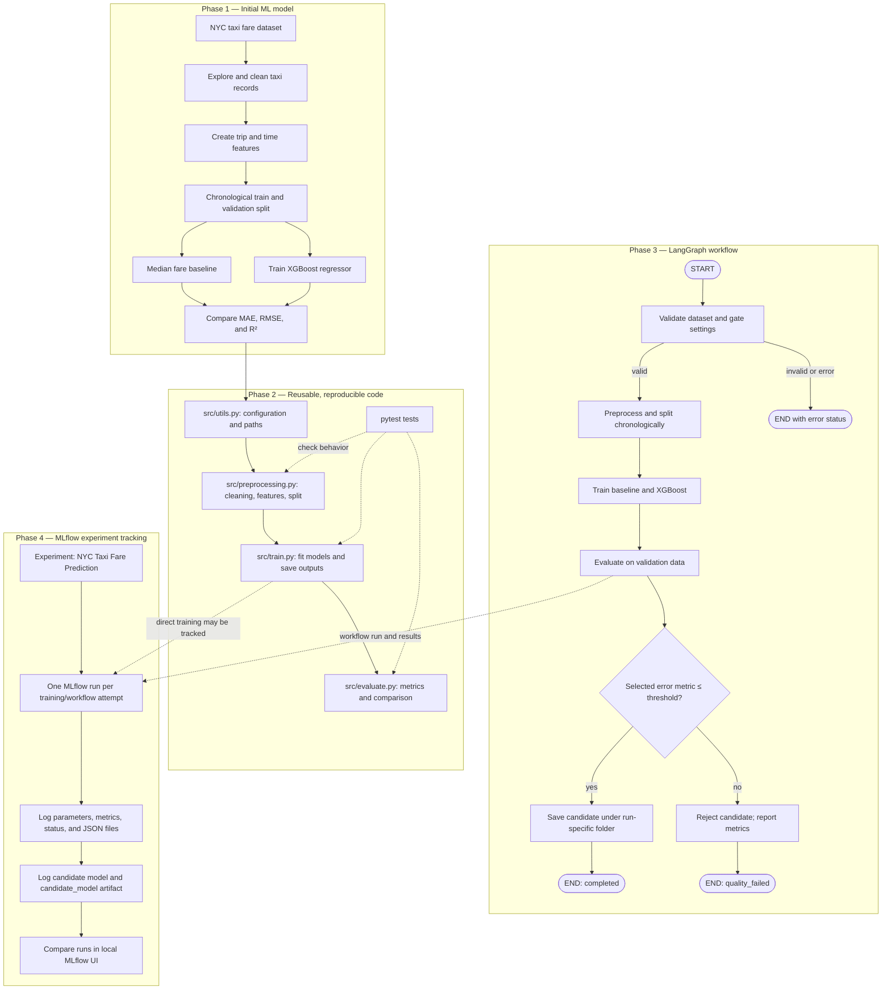

# NYC Taxi Fare Prediction: Phase 1 to Phase 4

This document describes the project based on the implementation details and run output reviewed during this conversation. The most recent full test run shown here finished with **7 passed**. The notebook, README, and current on-disk artifact directory were not inspected for this document, so their present contents are not asserted below.

## End-to-end flow

## Phase 1 — Initial ML model

**Problem and data.** The project predicts a taxi trip's fare from NYC taxi trip records. The workflow expects fare, pickup time and pickup/drop-off coordinates, and passenger count. The precise dataset filename and source are not restated here because the current data directory was not inspected.

**Exploration and preprocessing.** The initial work explored the trip data, cleaned records, and derived trip-distance, time, and calendar features. The current reusable preprocessing code includes cleaning, feature generation, and a chronological split.

**Models and evaluation.** A median-fare baseline provides a simple reference. XGBoost is compared with that baseline using MAE and RMSE (fare prediction error; lower is better) and R² (closer to 1 is better).

**Recorded reference values.** The Phase 1 values supplied for comparison were baseline MAE **$6.52**, and XGBoost MAE **$1.81**, RMSE **$3.39**, and R² **0.9011**. These are reference results reported for Phase 1, not a claim that the current workflow has just reproduced them. The exact Phase 1 artifact inventory has not been re-inspected for this document.

## Phase 2 — Reusable, reproducible code

The notebook remains the place for exploration, visualization, and experiments; reusable pipeline logic is in Python modules so training is not dependent on notebook variables.

| Module | Purpose |
|---|---|
| `src/preprocessing.py` | Clean records, create the established features, and make the chronological train/validation split. |
| `src/train.py` | Fit the median baseline and XGBoost model, assemble training results, and save training artifacts. |
| `src/evaluate.py` | Calculate and compare regression metrics. |
| `src/utils.py` | Hold shared settings, random/model configuration, and project-relative paths. |
| `Tests/` | Check preprocessing, metrics, small-data training and persistence, and workflow outcomes. |

The project also has `requirements.txt` for package versions and `.gitignore` rules intended to keep local data and generated files out of version control. Their current exact contents were not re-inspected here. The saved project model uses a joblib file, with feature and metrics JSON files; exact existing output files depend on the configured paths and run.

**What improved:** pipeline steps can be called as functions, paths/configuration are shared, and tests can exercise the code without running the exploratory notebook. The implementation uses a chronological split to keep later observations for validation.

## Phase 3 — LangGraph workflow orchestration

LangGraph connects the existing ML steps into an executable graph. **State** is the small shared record passed between steps; **nodes** are functions that perform work; **edges** say which step runs next; **conditional edges** choose the next step from the current result.

| Node | What it does and why it exists |
|---|---|
| `validate_data` | Checks that the data file and required columns exist, and validates the metric and threshold before training. |
| `preprocess_data` | Reuses cleaning, feature generation, and the chronological split so training and validation stay separate. |
| `train_model` | Fits the baseline and candidate model using the existing training function. |
| `evaluate_model` | Calculates the existing metrics on validation data. |
| `route_after_evaluation` | Sends an eligible candidate to saving or sends a failing candidate to rejection. |
| `save_candidate` | Saves a passing candidate in a run-specific directory so it does not replace the prior champion file. |
| `reject_candidate` | Sets `quality_failed` and keeps the evaluation metrics available in workflow state. |

The default gate is **validation MAE ≤ 2.00**. The workflow also supports RMSE; both supported metrics are error measures, so lower is better. The comparison is inclusive: a score exactly equal to the threshold is routed to saving. The default threshold was documented in the code as a modest margin above the reported Phase 1 XGBoost MAE (~1.81), while still below the baseline (~6.52); it is configurable at invocation.

The existing tests include a passing case (high threshold), a rejection case (very low threshold), and an invalid/missing dataset case. The pass test checks candidate file creation and preservation of a pre-existing champion; the rejection test checks that the local candidate directory is not created. No dedicated boundary-equality test was identified in the test output/code reviewed earlier.

## Phase 4 — MLflow experiment tracking

An **experiment** is the named collection for this project, **NYC Taxi Fare Prediction**. A **run** is one attempt to train or execute the workflow. Each run captures configuration and results so they can be compared in the local MLflow UI.

The tracking code records the XGBoost configuration and workflow parameters (including sample size, split description, seed, feature count, and quality gate settings), available baseline and candidate MAE/RMSE/R², improvement and run-size/timing values, workflow status, and evaluation/feature JSON files. It logs the model through MLflow and also writes a serialized copy under the run's `candidate_model` artifact folder for visibility in the run artifact listing. A quality-rejected candidate is not saved to the project's local candidate directory, but it can still be recorded in MLflow for comparison.

**What is verified:** the latest test output provided in this conversation reported **7 passed**. A test run performed during earlier troubleshooting initially failed because the local MLflow file store required `MLFLOW_ALLOW_FILE_STORE=true`; the successful run used that setting. The seven passing tests establish the behaviors those tests assert, including the passing and rejected workflow paths and candidate artifact listing. They do not establish equality-boundary behavior, every exception path, or that a fresh full-data training run reproduces Phase 1 metrics. The current MLflow UI/database and artifact files were not inspected while preparing this document.

## Phase summary

| Phase | What we built | What we achieved | Current status |
|---|---|---|---|
| 1 — Initial model | Notebook-based data exploration, preprocessing, baseline, and XGBoost comparison. | Reference results: baseline MAE $6.52; XGBoost MAE $1.81, RMSE $3.39, R² 0.9011. | Historical results reported; not freshly reproduced here. |
| 2 — Reproducible code | Reusable preprocessing, training, evaluation, and utility modules, dependencies, and tests. | Training logic can be called outside notebook cells and shared paths/configuration are centralized. | Implemented; current files were not all re-inspected for this document. |
| 3 — Workflow | LangGraph validation, preprocessing, training, evaluation, quality gate, and candidate-save/reject routes. | Pass/reject behavior and champion preservation are covered by workflow tests. | Implemented; latest reported suite included these tests and passed. Boundary and exception-specific tests remain absent. |
| 4 — Tracking | Local MLflow experiment and run logging for settings, metrics, status, JSON files, and candidate model records. | Runs can be compared in the local MLflow UI. | Implemented; latest reported suite: 7 passed with local file-store opt-in. Current UI/artifacts were not inspected for this document. |

## Interview explanation

“I started with an NYC taxi fare prediction notebook and compared a simple median baseline with XGBoost using MAE, RMSE, and R². I then moved reusable cleaning, feature engineering, training, and evaluation into Python modules, with a chronological validation split and tests. LangGraph now runs those steps in order and applies a configurable validation-error threshold: passing models are saved as separate candidates, while failing ones are rejected without replacing the champion. MLflow records each attempt’s settings, scores, status, and model artifacts so I can compare runs locally.”

## Local diagram preview

The Mermaid source is the fenced `mermaid` block near the top of this file. In a Mermaid-enabled Markdown preview, open `docs/project_flow.md` and confirm the diagram renders with four phase groups and both quality-gate branches. No preview or command was run while creating this document.
